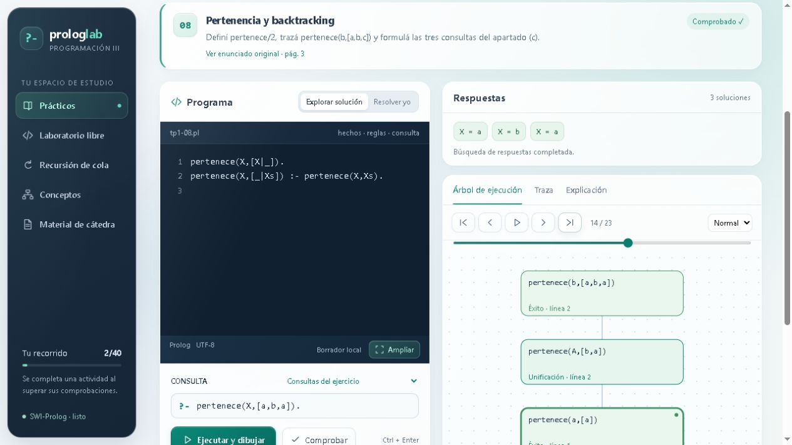
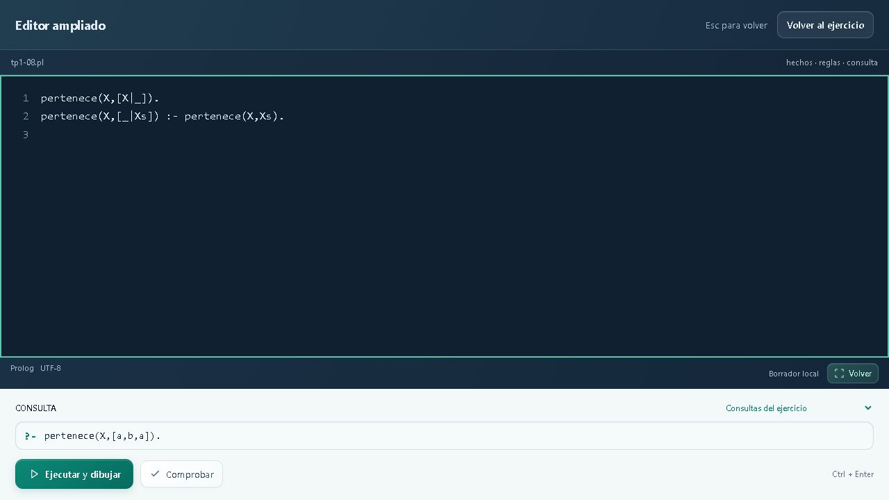

# Prolog Lab

Un laboratorio interactivo para aprender Prolog escribiendo código y siguiendo cómo se ejecutan las consultas. Nació para acompañar los prácticos de Programación III.

**[Abrir Prolog Lab](https://prolog-lab-lorenzo.bluecreek1.chatgpt.site/)** · Funciona en el navegador, sin instalar Prolog.



## Qué podés hacer

- Trabajar con 40 actividades: explorar soluciones comentadas o resolverlas por tu cuenta.
- Ejecutar consultas con SWI-Prolog real, ver las respuestas y comprobar los ejercicios.
- Recorrer el árbol de llamadas y la traza paso a paso: unificación, éxito, fallo, backtracking y corte.
- Practicar recursión de cola y acumuladores, comparando implementaciones.
- Experimentar en el laboratorio libre y descargar tu programa como `.pl`.
- Ampliar el editor a toda la ventana sin perder lo escrito. `Esc` vuelve al ejercicio; `Ctrl + Enter` ejecuta.
- Consultar los 11 PDFs distintos del material de cátedra.

La interfaz mantiene un estilo minimalista con paneles de vidrio, animaciones suaves y soporte para movimiento y transparencia reducidos. Los borradores y el progreso se guardan en el navegador de cada persona.



## Ejecutar en tu computadora

El proyecto es estático y no requiere instalar dependencias de JavaScript. Con Python 3 disponible, desde la raíz del repositorio:

```sh
python -m http.server 8000 --directory dist
```

Abrí **http://localhost:8000**. También podés usar cualquier servidor HTTP estático que sirva `dist`. Abrir `index.html` directamente como archivo no permite iniciar el Web Worker.

## Verificación

Con Node.js 22 o posterior:

```sh
node test-wasm.cjs
```

La suite usa el intérprete incluido y ejecuta 205 comprobaciones: 191 pruebas de soluciones y variantes, y 14 casos del motor que cubren traza, corte, errores, aislamiento, sandbox, límites, salida de texto y clasificación de recursión.

## Cómo funciona

La interfaz está escrita en HTML, CSS y JavaScript. SWI-Prolog 10.1.15 corre dentro de un Web Worker mediante el paquete oficial `swipl-wasm` 8.2.1. El motor y sus recursos se sirven junto con la aplicación.

```text
dist/
  index.html, app.js, styles.css   interfaz y actividades
  catalog.json                   consignas, soluciones y pruebas
  editor-expand.*                editor ampliado
  liquid-glass.css                tema y animaciones
  prolog-runtime.js               comunicación con el Worker
  prolog-worker.js, engine.pl     ejecución, comprobación y traza
  swipl/                         intérprete WebAssembly y licencia
  material/                      documentos de la cátedra
test-wasm.cjs                     verificación automatizada
docs/                            capturas
```

Los programas y consultas se procesan en el navegador; no se envían a un servidor para ejecutarlos. El guardado local no se sincroniza entre dispositivos. La primera visita descarga aproximadamente 4 MB del motor.

Cada consulta tiene límites de cinco segundos, 1,5 millones de inferencias, 30 respuestas, 2200 eventos de traza y 160 nodos dibujados. El sandbox bloquea operaciones externas y el puente a JavaScript. Al vencer el tiempo se termina el intérprete y la siguiente consulta inicia otro.

El árbol muestra las llamadas reales del depurador; no representa un árbol SLD completo. El análisis de recursión de cola identifica recursión directa y es una ayuda de estudio.

## Créditos y material

El intérprete proviene de [SWI-Prolog / npm-swipl-wasm](https://github.com/SWI-Prolog/npm-swipl-wasm). Su licencia BSD se conserva en [dist/swipl/LICENSE.txt](dist/swipl/LICENSE.txt).

Los PDFs pertenecen al material de la cátedra y conservan su autoría. Su inclusión no modifica sus derechos ni los convierte en contenido bajo la licencia del motor. Este repositorio todavía no declara una licencia general para el código propio.
